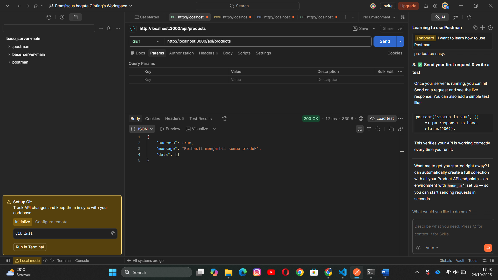
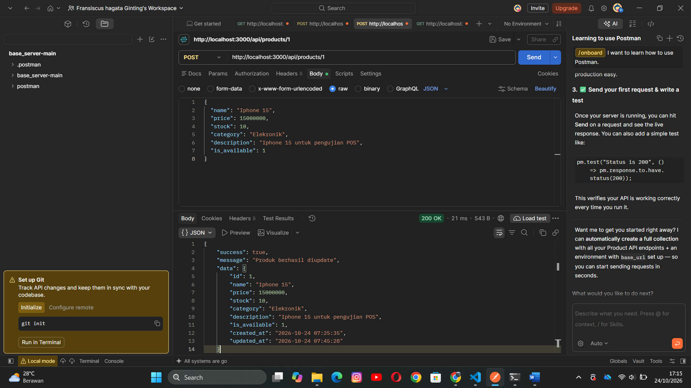
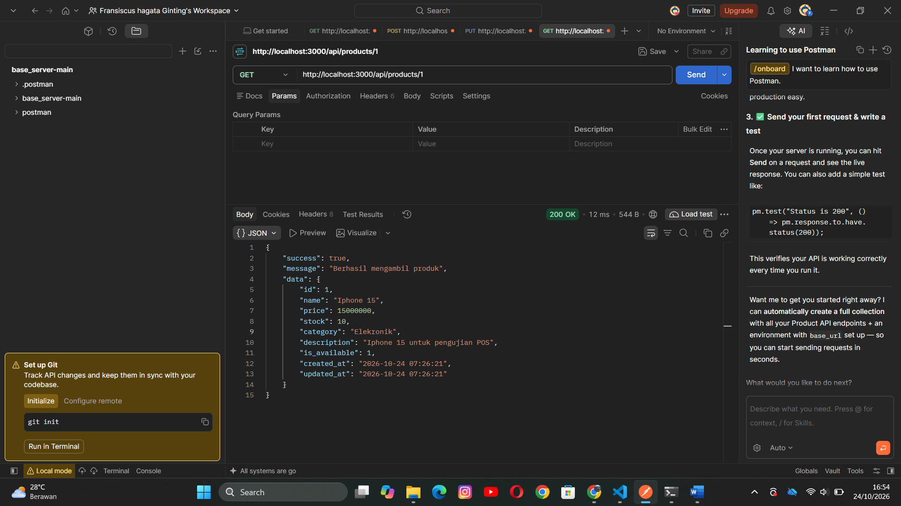

**Dokumentasi API POS**

1. Informasi umum 
    API ini merupakan backend untuk proyek Point of Sale (POS) yang dikembangkan menggunakan Node.js, Express.js, dan SQLite. API digunakan untuk mengelola data produk, termasuk menampilkan, menambahkan, memperbarui, dan menghapus produk.

**Base URL**: http://localhost:3000

**Format Data** = JSON

2. **Teknologi Yang Digunakan**

- Node.js Sebagai runtime JavaScript.
- Express.js sebagai framework backend.
- SQLite sebagai database.
- Postman Untuk Pengujuan API

**3. Daftar Endpoint**

| No. | Method | Endpoint            | Fungsi                          |
| --- | ------ | ------------------- | ------------------------------- |
| 1   | GET    | `/api/products`     | Mengambil semua produk          |
| 2   | GET    | `/api/products/:id` | Mengambil produk berdasarkan ID |
| 3   | POST   | `/api/products`     | Menambahkan produk baru         |
| 4   | PUT    | `/api/products/:id` | Memperbarui data produk         |
| 5   | DELETE | `/api/products/:id` | Menghapus produk                |

Keterangan: id merupakan ID produk yang ingin diakses.

**4. Detail Request API**

4.1 Menampilkan Semua Produk

Method: GET

Endpoint: /api/products

Contoh URL:

http://localhost:3000/api/products

Contoh response:

Response tersebut merupakan contoh hasil pengujian ketika belum ada produk yang dikembalikan oleh API.

4.2 Menambahkan Produk

Method: POST

Endpoint: /api/products

Header: Content-Type: application/json

Contoh request body:

4.3 Menampilkan Produk Berdasarkan ID

Method: GET

Endpoint: /api/products/:id

Contoh URL:

http://localhost:3000/api/products/1

contoh Response : 

Endpoint digunakan untuk mengambil data produk dengan ID tertentu.

4.4 Memperbarui Produk

Method: PUT

Endpoint: /api/products/:id

Contoh URL:

http://localhost:3000/api/products/1

Kirim data produk yang akan diperbarui melalui request body dalam format JSON sesuai dengan struktur data produk.

Kita mengetahui bahwa data produk tersebut sebelumnya adalah iPhone 15 lalu saya membuat dengan method Put dengan mengubah iPhone 15 menjadi Iphone 16 beserta daftar harga nya. seperti gambar diatas

4.5 Menghapus Produk

Method: DELETE

Endpoint: /api/products/:id

Contoh URL:

http://localhost:3000/api/products/1

Endpoint ini digunakan untuk menghapus produk berdasarkan ID.

**5. Cara Menjalankan API**

Buka folder proyek backend di Visual Studio Code.

1. Buka terminal pada folder proyek.
2. Jalankan perintah npm.cmd start.
3. Pastikan server berjalan pada http://localhost:3000.
4. Buka Postman untuk melakukan pengujian endpoint API.

6. Pengujian API

Pengujian dilakukan menggunakan Postman untuk memastikan endpoint dapat digunakan sesuai fungsinya.

Pengujian yang telah dilakukan:

1. GET untuk mengambil daftar produk.
2. POST untuk menambahkan produk.
3. GET berdasarkan ID untuk mengambil detail produk.
4. PUT untuk memperbarui produk.
5. DELETE untuk menghapus produk.

Hasil pengujian menunjukkan bahwa operasi Create,Read,Update,Delete produk telah berhasil dijalankan pada lingkungan lokal.

**7. Integrasi dengan Web Client**

Web Client dapat menggunakan API ini untuk mengambil dan mengelola data produk. Aplikasi web mengirimkan HTTP request ke endpoint backend, kemudian menerima response dalam format JSON.

Untuk pengembangan lokal, alamat http://localhost:3000 digunakan ketika client berjalan pada komputer yang sama. Apabila client berjalan pada perangkat lain, alamat server perlu disesuaikan.